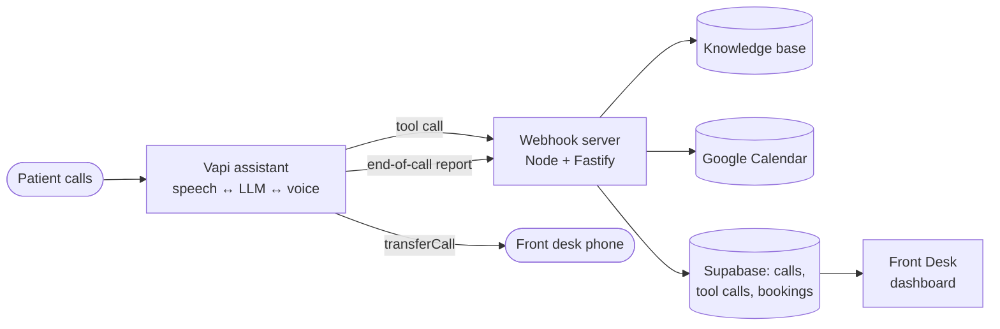

# Voice AI Clinic Receptionist

> **A receptionist that answers every call.** A patient calls the clinic and talks to an AI voice assistant. It answers questions from the clinic's knowledge base (services, prices, hours, insurance, how to prepare for a visit), checks free slots in Google Calendar and books the appointment while the caller is still on the line. When it can't help, or the caller asks for a person, it transfers the call to the front desk. Every call is logged in Supabase with the transcript, the recording, the summary and what was booked. **Front Desk**, a React dashboard, shows the calls and the appointments.


The demo clinic is **Brightside Dental**, a made-up practice with three dentists, a hygienist and a price list. Its details live in one file, so the same setup works for any clinic.

## How it works



1. **The call** comes in to a Vapi phone number. Vapi turns speech into text, runs the conversation with an LLM and speaks the answers back.
2. **When the assistant needs facts or an action**, it calls a function. Vapi posts the call to this server's `/vapi/webhook`, signed with a shared secret, and reads the result back to the model in the same turn.
3. **Questions** ("Do you take Delta Dental?", "How much is a cleaning?") are answered from the clinic's knowledge base, never from the model's memory. If the answer is not there, the assistant says so and offers a person.
4. **Booking**: the assistant asks what the visit is for and when suits the caller, checks free slots in the clinic's Google Calendar (working hours, visit length and existing appointments), reads two or three options, confirms the name and phone number and creates the event. The slot is checked again right before booking, so two callers can't get the same time.
5. **Transfer to a person** when the caller asks for one, for anything urgent or clinical, or when a tool fails. Vapi's `transferCall` forwards the live call to the front desk.
6. **After the call** Vapi sends an end-of-call report. The server stores the call in Supabase: who called, how long, the transcript, the recording link, the summary, the outcome (booked, answered, transferred, hung up) and every tool call with its result.

### The assistant's functions

| Function | What it does |
|---|---|
| `search_knowledge_base` | Finds the answer to a question in the clinic's knowledge base |
| `check_availability` | Free slots for a service on a date (or the next days), from Google Calendar |
| `book_appointment` | Re-checks the slot and creates the calendar event with the patient's details |
| `transferCall` | Vapi's built-in transfer to the front desk number |

The tool server answers every call, even when something breaks: a failing tool returns an error the assistant can act on ("the system is unavailable, let me transfer you"), never a dropped turn. Internal errors are logged, not read out to the caller.

## The knowledge base

Everything the assistant knows about the clinic is in two files in [`server/data/`](server/data):

- **[`clinic.json`](server/data/clinic.json)**: name, contacts, time zone, opening hours, dentists, services (visit length, price, who does it, words callers use for it), insurance plans and languages. It is checked with a Zod schema when the server starts: a typo in the hours, or a service done by a dentist who doesn't exist, stops the server with a clear message instead of reaching a caller. Booking (PR 3) reads the same file, so the assistant never quotes a visit length or opening hours the calendar doesn't use.
- **[`faq.md`](server/data/faq.md)**: policies and common questions (parking, cancellations, payment and financing, emergencies after hours, children, sedation, X-rays in pregnancy…). One `##` heading per answer, with an optional `keywords:` line for words callers use that the text doesn't.

Swapping in another clinic means editing these two files; no code changes.

**Search.** `search_knowledge_base` runs a keyword search (BM25) over the entries, written for how people talk on the phone: stop words and filler ("um", "really") are dropped, plurals and verb forms are folded ("cleaning" → "clean"), and callers' words are mapped to the clinic's ("how much" → price, "my tooth hurts" → emergency, "braces" → clear aligners). No model call and no embeddings: an answer takes under a millisecond during a live call, costs nothing, and the same question always gets the same answer, so the search can be tested.

**Knowing what it doesn't know.** A good-looking match is not always an answer: "Who won the game last night?" shares the word "night" with the after-hours emergencies entry. So the best entry must also cover at least half of the question's meaning, with each word weighted by how rare it is; a word the knowledge base has never seen ("botox", "weather") weighs the most. When nothing passes, the assistant gets `{"found": false}` and an instruction not to guess but to offer the front desk.

```jsonc
// search_knowledge_base({ "query": "how much is a root canal" })
{
  "found": true,
  "answers": [
    {
      "topic": "Root canal",
      "answer": "Root canal: Treats an infected or badly inflamed tooth nerve and saves the tooth. … It takes about 90 minutes and costs from $950 (front teeth; molars from $1,200). With Dr. James Okafor.",
      "serviceId": "root-canal"   // what book_appointment takes
    }
  ]
}
```

The [tests](server/src/knowledgeBase/search.test.ts) ask 25 questions the way callers ask them ("My son knocked out his tooth playing soccer", "I'll be 20 minutes late", "Can you prescribe antibiotics?") and check the right entry comes first, plus 10 that must not be answered ("Do you do knee surgery?", "Do you sell car insurance?").

In **Front Desk**, the **Knowledge base** page shows the clinic, the services and the FAQ, and has a box to ask a question like a caller and see exactly what the assistant would get back. The question is kept in the link: [`/knowledge-base?q=Do you take Delta Dental?`](http://localhost:8080/knowledge-base?q=Do%20you%20take%20Delta%20Dental%3F).

## Roadmap

The project is built pull request by pull request:

| # | Pull request | Status |
|---|---|---|
| 1 | **Project setup**: webhook server with the Vapi secret check and tool dispatcher; Front Desk dashboard shell (layout, light and dark mode, server status); tests, CI, Docker | ✅ |
| 2 | **Knowledge base**: Brightside Dental's services, prices, hours, insurance and FAQ; `search_knowledge_base`; the Knowledge base page in Front Desk | ✅ |
| 3 | **Google Calendar**: `check_availability` and `book_appointment`, with tests for the slot and booking logic | |
| 4 | **Call log in Supabase**: schema and migrations; end-of-call reports, tool calls and bookings stored | |
| 5 | **The Vapi assistant**: system prompt, tools, transfer to a person; a script that creates or updates it through the Vapi API | |
| 6 | **Calls and appointments in Front Desk**: calls with transcript, recording, outcome and bookings; stats | |
| 7 | **A real test call**: recording, transcript and walkthrough in this README | |

## Tech stack

| | |
|---|---|
| **Voice** | Vapi (telephony, speech-to-text, LLM, text-to-speech, call transfer) |
| **Server** | Node.js 22, TypeScript (strict), Fastify 5, Zod 4 |
| **Integrations** | Google Calendar API, Supabase (Postgres) |
| **Web UI** | React 19, TypeScript (strict), Vite, Material UI 9 (light and dark), TanStack Query, React Router |
| **Tests** | Vitest: requests injected into the Fastify app; Testing Library for the UI |
| **Quality** | oxlint, Prettier, pre-commit, GitHub Actions |
| **Deploy** | Docker Compose: the server (multi-stage image, non-root, health check) and the UI (nginx, proxies `/api` and `/health` to the server) |

## Quick start

Requires Docker with Compose.

```bash
cp .env.example .env          # set VAPI_SERVER_SECRET: openssl rand -hex 24
docker compose up -d --build
```

| | |
|---|---|
| **Front Desk** (web UI) | http://localhost:8080 |
| **Webhook server** | http://localhost:3000 |

### Without Docker

Requires Node 20.19+. In two terminals:

```bash
cd server && npm install && npm run dev     # http://localhost:3000
cd client && npm install && npm run dev     # http://localhost:5173
```

The Vite dev server proxies `/api` and `/health` to the webhook server, like nginx does in Docker.

Check that it is up:

```bash
curl localhost:3000/health
# {"status":"ok","uptime":3}

curl -X POST localhost:3000/vapi/webhook \
  -H "content-type: application/json" \
  -H "x-vapi-secret: $(grep ^VAPI_SERVER_SECRET .env | cut -d= -f2)" \
  -d '{"message":{"type":"tool-calls","toolCallList":[{"id":"t1","function":{"name":"search_knowledge_base","arguments":{"query":"are you open on saturday"}}}]}}'
# {"results":[{"toolCallId":"t1","name":"search_knowledge_base","result":"{\"found\":true,\"answers\":[{\"topic\":\"Opening hours\",\"answer\":\"Brightside Dental is open Monday to Thursday 8 AM to 6 PM; Friday 8 AM to 3 PM; Saturday 9 AM to 1 PM; closed on Sunday. …\"}]}"}]}
```

### API

| | |
|---|---|
| `POST /vapi/webhook` | Vapi server messages; needs the secret |
| `GET /health` | Liveness |
| `GET /api/clinic` | The clinic, with hours and prices as the assistant says them |
| `GET /api/knowledge-base` | All entries |
| `GET /api/knowledge-base/search?q=` | A search with scores, plus the exact tool result the assistant gets |

Vapi has to reach the server over HTTPS. For local development, expose it with a tunnel (`ngrok http 3000` or `cloudflared tunnel --url http://localhost:3000`) and use `https://<tunnel>/vapi/webhook` as the assistant's Server URL, with the same secret.

### Settings

| Variable | Default | |
|---|---|---|
| `VAPI_SERVER_SECRET` | (required) | Shared secret Vapi sends in `x-vapi-secret` or as a Bearer token. 16+ characters |
| `PORT` | `3000` | Port the server listens on |
| `SERVER_PORT`, `WEB_PORT` | `3000`, `8080` | Ports on the host, with Docker Compose |
| `LOG_LEVEL` | `info` | `debug` logs every Vapi message |

### Scripts (in `server/` and `client/`)

| | |
|---|---|
| `npm run dev` | Server with reload and readable logs; the UI with hot reload |
| `npm test` | Tests |
| `npm run lint`, `npm run format` | oxlint, Prettier |
| `npm run typecheck`, `npm run build` | TypeScript |

Pre-commit runs the same checks before each commit: `pre-commit install`.

## Project structure

```
server/                 the webhook server
  data/
    clinic.json       the clinic: hours, services, prices, dentists, insurance
    faq.md            policies and common questions
  src/
    index.ts          entry point: reads .env, starts the server, shuts down cleanly
    app.ts            builds the Fastify app (used by the tests too)
    config.ts         environment variables, checked with Zod
    routes/           GET /health; /api for Front Desk
    clinic/           clinic.json schema; hours and prices as they are said
    knowledgeBase/    entries from both files, text processing, BM25 search
    tools/            the assistant's functions and their definitions for Vapi
    vapi/
      routes.ts       POST /vapi/webhook
      auth.ts         shared-secret check, constant time
      schemas.ts      Vapi server messages
      tools.ts        runs tool calls: one result per call, errors the model can act on
client/                 Front Desk, the web UI
  src/
    app/              theme, router, query client
    api/              typed fetch client
    components/layout sidebar, header (server status, theme toggle), footer
    features/         pages: dashboard, knowledge base, not found
  nginx.conf          serves the build, proxies /api and /health to the server
```
